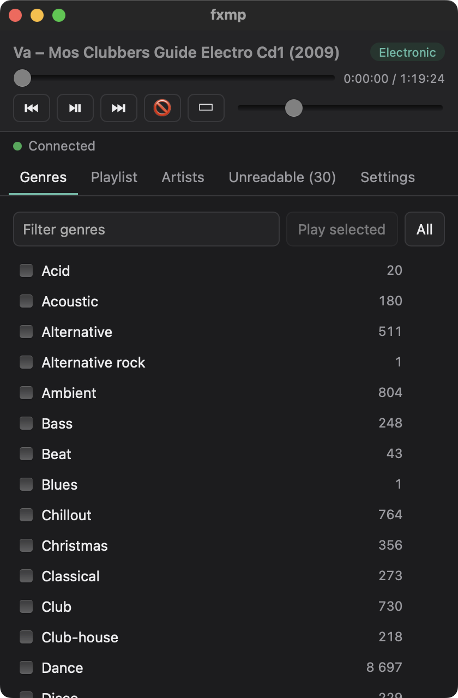

# fxmp — fx music player

A music player that plays your collection straight from a network share
(SMB) or a local folder, shuffled by genre. For macOS and Windows, with a test
build for Android. Plays MP3, FLAC and OGG Vorbis.

## What it can do

- **Plays straight from the share**: connects to the SMB server on its own (no
  mounting), reads the music folder into a local library and groups the tracks
  by the genres in their tags.
- **Several music sources**: more SMB servers and local folders (an external
  disk, a mounted network volume) play together; each can be switched off.
- **Backup server**: a mirror of the music takes over when the main server does
  not answer, and the player goes back as soon as it does.
- **Shuffle by genre**: play one genre, several, or everything, with no repeats
  within a pass; mix more genres into what is playing without stopping it.
  Genres can be merged, odd tag spellings are recognized.
- **Smooth sound**: crossfade (1–10 s), a short fade on Next, volume
  normalization (ReplayGain or measured loudness), stereo on all speakers of a
  5.1/7.1 system.
- **Playlist, artists and albums**: see what plays and what comes next, filter
  it, reorder it, play an album in order, export the playlist as `.m3u8`. The
  playlist and the position survive a restart.
- **Look tracks up** on Last.fm, MusicBrainz, Discogs, Wikipedia, YouTube or
  Genius with a right click, or copy "Artist – Title (Year)".
- **Lives in the menu bar / tray**: one click pauses, a double click skips;
  volume and output device from the menu; media keys, Now Playing, optional
  notifications, start at login, and a mini player.
- **Steps aside for calls**: while an app uses the microphone, the music is
  lowered or paused (or it asks), and comes back afterwards.
- **Unreadable files** are listed with the reason, never with a password, and
  can be retried; tracks you never want to hear again can be banned.
- **Portable**: put a data folder next to the app (e.g. on a USB stick) and it
  carries its own settings and library.
- **On the phone**: the Android build plays with the screen off, with the
  controls in the notification.
- **Private**: passwords stay in the macOS Keychain, the Windows Credential
  Manager or the Android Keystore, never in a file or a log.
- English and Croatian.

## Download

Builds are on the [Releases](https://github.com/fx02/fxmp/releases) page.
Installation and the full guide: [docs/MANUAL.md](docs/MANUAL.md).
